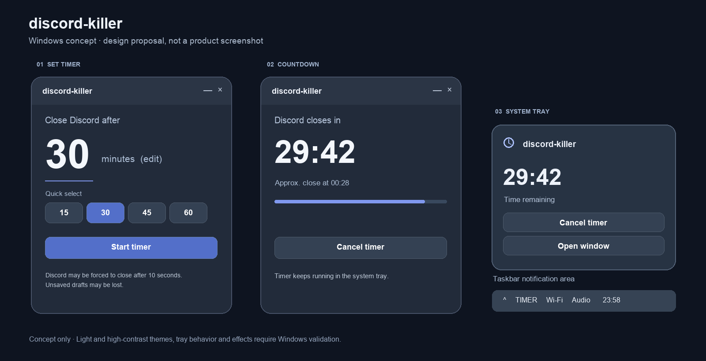

<div align="center">

# discord-killer

**A sleep timer for Discord.**

Fall asleep in voice chat without leaving Discord running all night.

[Downloads & releases](https://github.com/Stronskiy/discord-killer/releases) · [Repository checks](https://github.com/Stronskiy/discord-killer/actions) · [License](LICENSE)

</div>

> [!CAUTION]
> **Early development:** real Discord shutdown is disabled while Windows process identification is being validated. Do not rely on this project to close Discord yet. There is no published Windows release.



*Design concept, not a screenshot. The final Windows interface and system tray behavior have not yet been verified interactively.*

## Why discord-killer?

Sometimes you want to fall asleep while friends are still chatting. discord-killer is intended to close the desktop Discord app after a chosen delay, helping prevent unexpected voice chat sounds from waking you and freeing the resources Discord was using.

## Planned experience

1. Choose a preset or enter a duration from **1 to 720 minutes**.
2. Start the timer and keep discord-killer running in the Windows system tray.
3. When time is up, discord-killer will attempt to close Discord normally. If a verified target process is still running after 10 seconds, it may then be forced to quit.
4. Open the app or tray panel to see the result, or cancel the timer before shutdown begins.

Forced termination can cause unsaved Discord drafts to be lost. A request to close a window does not guarantee that Discord has exited; the intended implementation must confirm the actual process has stopped and report failures.

The Windows app is planned for **Windows 11 x64**, with an English and Russian interface, a main window, and a compact tray panel. Its appearance, tray integration, sleep/wake behavior, supported Discord builds, and actual shutdown behavior require interactive Windows validation. The existing macOS app is a separate local prototype and is not included in this repository yet.

## Download

**No release is available yet.** Once a preview is ready, its Windows archive, checksum, instructions, and known limitations will be published on the [Releases page](https://github.com/Stronskiy/discord-killer/releases).

The initial distribution is planned as a self-contained Windows x64 ZIP. An unsigned build may trigger a Windows security warning; the packaging and signing approach are still being determined.

## Development

The Windows preview is written in C# with .NET 10 and WPF. With the .NET 10 SDK installed, build and test from the repository root:

```powershell
dotnet test tests/DiscordKiller.Core.Tests/DiscordKiller.Core.Tests.csproj -c Release
dotnet publish src/DiscordKiller.Windows/DiscordKiller.Windows.csproj -c Release -r win-x64 --self-contained true
```

GitHub Actions can verify the source and build on Windows, but it does not by itself prove that the system tray, UI, sleep/wake, or a real Discord session works correctly.

Please use pull requests for changes. See [AGENTS.md](AGENTS.md) for the repository's agent and development workflow. Never add local `docs/`, secrets, build artifacts, or Discord-derived assets to a pull request without an explicit provenance and permissions review.

## License and attribution

The project's own code is available under the [Apache License 2.0](LICENSE). Third-party trademarks and assets are not covered by that license.

discord-killer is an independent project and is not created, maintained, or endorsed by Discord. Discord is a trademark of its respective owner.
